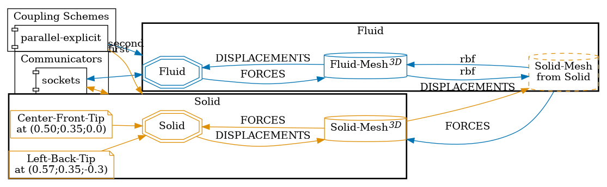
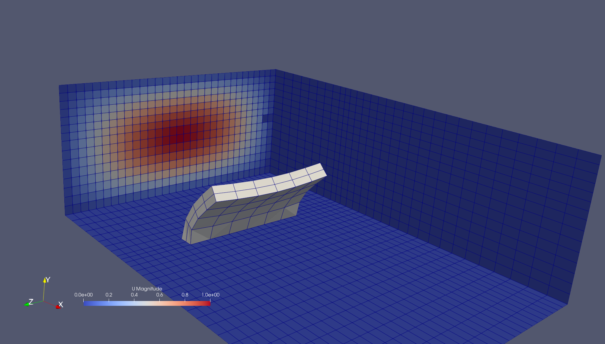
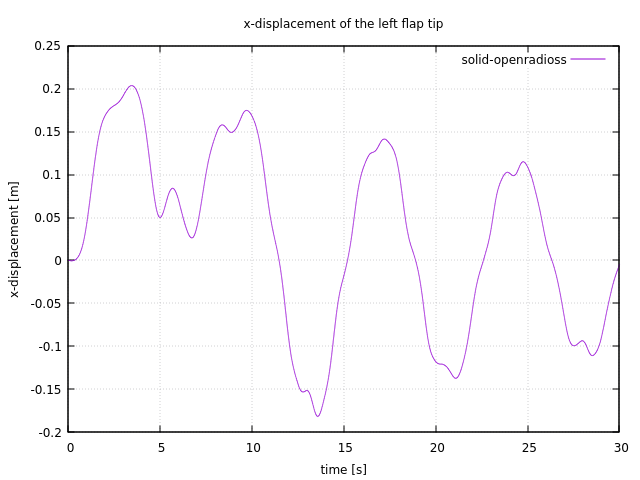
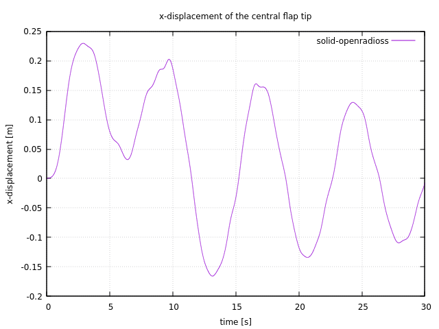


Get the [case files of this tutorial](https://github.com/precice/tutorials/tree/develop/perpendicular-flap-3d), as continuously rendered here, or see the [latest released version](https://github.com/precice/tutorials/tree/master/perpendicular-flap-3d) (if there is already one). Read how in the [tutorials introduction](https://precice.org/tutorials.html).


## Setup

This tutorial is derived from the "Pulsating flow over flexible flap" test case discussed in the [OpenFOAM-preCICE paper](https://doi.org/10.51560/ofj.v3.88) (comparing to a [benchmark from the literature](https://doi.org/10.1002/nme.6072)),
and it was originally designed to validate OpenRadioss as a solid participant in fluid-structure interaction.
In contrast to the discussed case, this is using an explicit coupling scheme with a smaller coupling time window / solver time step.

Overall, this tutorial consists of a 3D flow channel with an elastic flap perpendicular to the flow, anchored from the bottom. The inlet velocity oscillates over time, and the flap deforms in all dimensions.

## Configuration

preCICE configuration (image generated using the [precice-config-visualizer](https://precice.org/tooling-config-visualization.html)):



## Available solvers

Fluid participant:

* OpenFOAM (pimpleFoam). For more information, have a look at the [OpenFOAM adapter documentation](https://precice.org/adapter-openfoam-overview.html). This tutorial needs the OpenFOAM adapter v1.4.0 or later.

Solid participant:

* OpenRadioss. While [OpenRadioss is no longer maintained](https://en.wikipedia.org/wiki/Radioss), the community fork [OpenCourant](https://opencourant.org/) is actively maintained and works with this tutorial. OpenCourant needs to [be built with preCICE enabled](https://github.com/OpenCourant/OpenCourant/tree/main/engine/source/coupling).
In addition to the `starter` and `engine`, you will need to build the [`anim_to_vtk` tool](https://github.com/OpenCourant/Tools/tree/main/output_converters/anim_to_vtk).

## Mesh Configuration

The test case implemented within this repository implements what the [OpenFOAM-preCICE paper](https://doi.org/10.51560/ofj.v3.88) refers to as `coarse` mesh:
The OpenRadioss `Solid` domain is discretized with 48 `HEX20` solid elements, arranged with a 2 x 4 x 6 cell resolution along the three spatial directions.

## Running the simulation

Open two separate terminals and start the desired fluid and solid participant by calling the respective run script `run.sh` located in the participant directory. For example:

```sh
# Terminal 1
cd fluid-openfoam -parallel
./run.sh

# Terminal 2
cd solid-openradioss
./run.sh
```

The scripts rely on tools found in `../tools/`.

OpenFOAM can be executed in parallel using `run.sh -parallel`.
The default setting uses 8 MPI ranks, but you can increase the number of subdomains in `system/decomposeParDict`.
Since this case takes a long time to complete, you probably want to run the fluid case in parallel.

## Post-processing

OpenCourant (same as OpenRadioss) writes `.anim` files, which can be converted to VTK using the [`anim_to_vtk` tool](https://github.com/OpenCourant/Tools/tree/main/output_converters/anim_to_vtk) tool. This tool can be called (commented out by default) at the end of `solid-openradioss/run.sh` using the alias `toVTK`, defined in `tools/setup-openradioss.sh`.

OpenFOAM results can directly be loaded in ParaView ([visualization details](https://precice.org/tutorials/visualization/)).

At `t=2.5 s`, the flap should deform as follows:



Two watchpoints are defined: one in the center of the flap, and one on its left tip. These can be visualized using the provided gnuplot script:

```shell
./plot-displacement.sh solid-openradioss
```

Expected results for the two watchpoints (left and center of the flap):




Detailed results can be found in the [`openradioss-cases` repository](https://github.com/elisa-santoro/openradioss-cases) and in the [Master's thesis of Elisa Santoro](https://webthesis.biblio.polito.it/id/eprint/40822).
